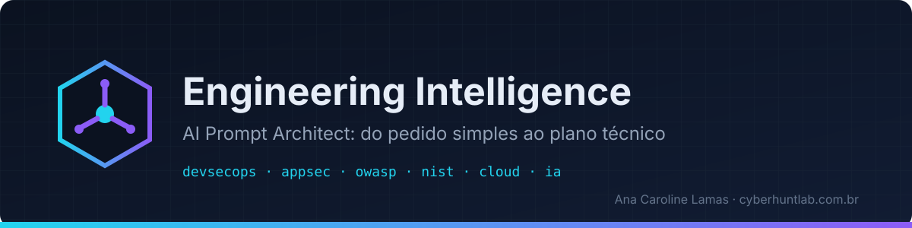

<p align="center"></p>

# Engineering Intelligence — AI Prompt Architect

Você descreve o que quer construir em uma frase. A ferramenta identifica o tipo de projeto, ativa as **especialidades** necessárias, seleciona **normas e metodologias** (OWASP, NIST, LGPD, STRIDE…) só quando elas se aplicam e gera um **prompt técnico em 19 seções**, pronto para usar numa IA de desenvolvimento.

> Não é um gerador de prompts genérico. A base de conhecimento vem das competências de engenharia de software, DevSecOps, AppSec, SecOps, Cloud, IA e pesquisa de segurança de Ana Caroline Lamas. Referenciais como SLSA, CIS e ISO entram como conhecimento do motor, não como qualificações atribuídas a ela.

## Como funciona

| Etapa | O que acontece |
|---|---|
| Interpretação | Detecta sinais no pedido: web, API, mobile, dados, IA, pagamentos, dados pessoais, infraestrutura, automação, SecOps. |
| Modo | Escolhe entre **desenvolvimento**, **pesquisa de vulnerabilidades**, **melhoria de projeto**, **infraestrutura** e **IA**. |
| Mapeamento | Ativa só as especialidades e os referenciais pertinentes e explica por que cada um entrou. |
| Prompt | Gera 19 seções: do executor e requisitos até critérios de aceitação e evidências de funcionamento. |

Exemplos:

- *"Quero desenvolver um e-commerce"* → Full stack, AppSec, DevSecOps, Pagamentos · NIST SSDF, OWASP ASVS, Top 10, API Top 10, STRIDE, **LGPD**, **PCI DSS**, SLSA.
- *"Quero pesquisar vulnerabilidades em um programa de Bug Bounty"* → modo pesquisa · OWASP WSTG, CWE/CVE/CVSS, Top 10, com regras de escopo autorizado.
- *"Quero desenvolver um aplicativo Android"* → Mobile, AppSec, DevSecOps · NIST SSDF, **OWASP MASVS**, STRIDE, SLSA.

## Dois motores, sem caixa-preta

1. **Motor local** (`lib/engine.js`): regras determinísticas, roda no navegador, sem enviar nada a servidor e sem custo. É ele que sempre responde.
2. **Refinamento por IA** (opcional, `api/generate.js`): se a dona do servidor configurar um provedor, o modelo recebe o [prompt mestre](lib/master-prompt.js) e a análise local como base. Tem **limite por visitante e limite diário**, tempo máximo de resposta e volta para o motor local se algo falhar. A interface sempre mostra qual motor gerou o resultado.

## Estrutura

```
index.html  styles.css  app.js     interface (HTML/CSS/JS puro)
lib/engine.js                      motor de interpretação (ESM, sem dependências)
lib/master-prompt.js               prompt mestre usado pela IA
api/generate.js                    POST /api/generate (função serverless)
api/health.js                      GET /api/health (diz se a IA está ativa, sem expor chaves)
api/_shared.js                     limites de uso, leitura de JSON, configuração
tests/                             testes com node:test
vercel.json                        cabeçalhos de segurança (CSP, HSTS…) e funções
```

## Rodar e testar

```bash
npm test          # 14 testes do motor e da API (Node 18+, sem instalar nada)
npx vercel dev    # servidor local com as funções
```

## Deploy na Vercel

1. Importe o repositório na Vercel. Não há build: o site é estático e as funções ficam em `api/`.
2. (Opcional) Para ativar a IA, cadastre em **Settings → Environment Variables** as variáveis de [`.env.example`](.env.example): `AI_PROVIDER` (`openai` ou `gemini`), `AI_API_KEY`, `AI_MODEL` e os limites. Provedores compatíveis com a API da OpenAI (Groq, OpenRouter, DeepSeek, NVIDIA) usam `AI_BASE_URL`.

Sem variáveis, o app funciona inteiro com o motor local.

## Segurança

- A chave de IA fica só no servidor; `/api/health` informa apenas se a IA está ativa.
- Entrada limitada a 2.000 caracteres; corpo JSON limitado a 16 KB.
- Limite por IP e diário para não consumir a cota (em memória, por instância; para limite global use Vercel Firewall ou KV).
- CSP restrita (`script-src 'self'`), HSTS, `frame-ancestors 'none'`, sem scripts de terceiros.

## Licença

MIT · Ana Caroline Lamas · [cyberhuntlab.com.br](https://cyberhuntlab.com.br)
